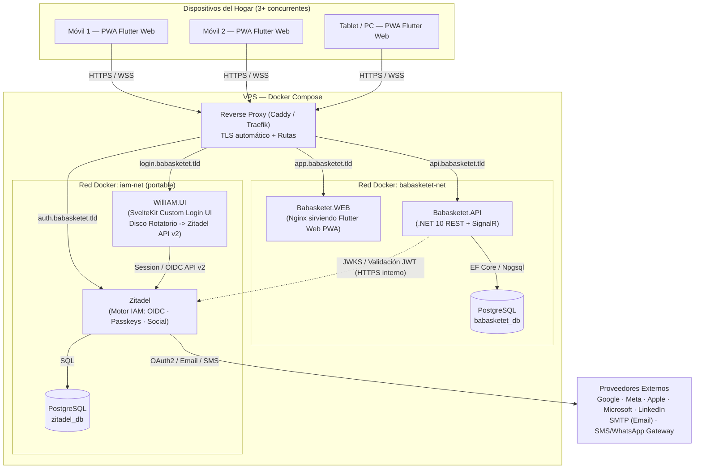

# Arquitectura del Sistema — Babasketet

## 1. Visión General

**Babasketet** está diseñado como una plataforma **container-first** preparada para desplegarse en un único VPS (mediante Docker Compose) y escalar en funcionalidad (PWA Web → Apps nativas Android/iOS) manteniendo **desacoplado el subsistema IAM (`WillIAM`)** para reutilizarlo en futuros proyectos.

---

## 2. Decisiones Arquitectónicas Clave

### 2.1 Separación de Bases de Datos PostgreSQL
- `babasketet_db`: Exclusiva del dominio de Babasketet (casas, tiendas, productos, tipos, lista, cesta, histórico de precios, compras).
- `zitadel_db`: Exclusiva de **Zitadel** (usuarios, Passkeys/WebAuthn, conectores OAuth, sesiones, clientes OIDC, auditoría, claves de firma).
- **Despliegue en VPS**:
  - **Opción A (Recomendada para VPS modesto — 2 a 4 GB RAM)**: Un único contenedor `postgres:17-alpine` con un script de inicialización (`init-multiple-dbs.sh`) que crea dos bases de datos (`babasketet_db`, `zitadel_db`) y **dos roles PostgreSQL independientes con permisos aislados** (ningún servicio puede leer la BD del otro).
  - **Opción B (Máximo aislamiento / portabilidad directa)**: Dos contenedores PostgreSQL separados, cada uno en su propio `docker-compose.yml` (`babasketet` y `iam-zitadel`).
- En ambos casos, **Zitadel + `WillIAM.UI`** son completamente portables a futuros proyectos simplemente añadiendo nuevos proyectos/aplicaciones OIDC desde la consola de Zitadel.

### 2.2 Sincronización Multi-Dispositivo (3 o más dispositivos)
Cuando varias personas compran simultáneamente (o alguien añade leche desde casa mientras otra persona está en Mercadona):
1. **Canal en tiempo real**: `Babasketet.API` expone un **SignalR Hub** (`/hubs/house`) sobre WebSockets. Al abrir una casa, el cliente se suscribe al grupo `house:{houseId}`.
2. **Eventos broadcast**: Cualquier mutación (`ItemAdded`, `ItemMovedToBasket`, `ItemRemoved`, `ItemReordered`, `BasketQuantityUpdated`, `PriceUpdated`, `PurchaseCompleted`, `StoreChanged`) emite un evento ligero a todos los dispositivos del grupo.
3. **Resiliencia en supermercados con mala cobertura (Offline-First ligero)**:
   - La PWA guarda una instantánea local del estado de la casa activa (IndexedDB/Hive).
   - Al perder conectividad, las acciones se encolan localmente con `clientMutationId` (idempotencia) y timestamp.
   - Al recuperar red, la cola se sincroniza contra `Babasketet.API` y se reconcilia mediante política *Last-Write-Wins (LWW)* por campo/ítem.

### 2.3 Modelo de Identidad Híbrido (Anónimo + Registrado)
- **Usuario Anónimo (sin alta)**:
  - Al crear o unirse a una casa sin cuenta, `Babasketet.API` emite un `deviceToken` (JWT firmado por la API con `deviceId` y `houseId`) o el cliente genera un `deviceId` persistido localmente asociado a esa casa.
  - Límite estricto en servidor y cliente: **máximo 1 casa**.
- **Usuario Registrado (`WillIAM`)**:
  - Autenticado vía OIDC/JWT emitido por `WillIAM`.
  - Al iniciar sesión desde un dispositivo que ya tenía una casa anónima, `Babasketet.API` ejecuta un endpoint de **vinculación (`POST /api/v1/houses/claim`)** que asocia la casa local al `userId` (`sub` del JWT) sin perder datos.
  - Límite ampliado: **hasta 4 casas** accesibles desde cualquier dispositivo donde inicie sesión.

---

## 3. Topología Docker Compose (VPS)

### Servicios Principales

| Servicio | Imagen / Build | Puerto Interno | Exposición | Notas |
| :--- | :--- | :--- | :--- | :--- |
| `proxy` | `caddy:2-alpine` | `80`, `443` | Público | TLS automático Let's Encrypt, compresión zstd/gzip, WebSocket upgrade |
| `web` | Build multi-stage Flutter → `nginx:alpine` | `80` | Vía `proxy` | Sirve `Babasketet.WEB` PWA con cabeceras `Service-Worker-Allowed` y fallback SPA |
| `api` | Build multi-stage `.NET 10 SDK` → `aspnet:10.0-alpine` | `8080` | Vía `proxy` | REST + SignalR + Healthchecks (`/health/live`, `/health/ready`) |
| `zitadel` | `ghcr.io/zitadel/zitadel:latest` | `8080` | Vía `proxy` | Motor IAM portable (OIDC, Passkeys, Social, Admin Console) |
| `william-ui` | Build multi-stage `node:22-alpine` (SvelteKit) | `3000` | Vía `proxy` | Login UI propia (Disco Rotatorio + WebAuthn) sobre Zitadel API v2 |
| `postgres` | `postgres:17-alpine` | `5432` | Solo red interna | Volumen persistente `pgdata`, bases `babasketet_db` y `zitadel_db` |

### Subdominios Recomendados en VPS
- `https://app.tu-dominio.com` → `Babasketet.WEB` (PWA)
- `https://api.tu-dominio.com` → `Babasketet.API` (REST + SignalR)
- `https://auth.tu-dominio.com` → `Zitadel` (Issuer OIDC + Consola Admin + API v2)
- `https://login.tu-dominio.com` → `WillIAM.UI` (Login UI personalizada con disco rotatorio y Passkeys)

*(Alternativa sin subdominios múltiples: enrutamiento por path `/`, `/api`, `/hubs`, `/auth` desde un único dominio, aunque un subdominio propio para `WillIAM` facilita enormemente portarlo a otros proyectos.)*

---

## 4. Seguridad y Observabilidad

- **HTTPS obligatorio**: Requerido tanto para la instalación de la **PWA** (Service Workers) como para las cookies `HttpOnly; Secure; SameSite=Lax` de BetterAuth y los callbacks OAuth2 (Google, Apple, Meta, Microsoft, LinkedIn).
- **CORS estricto**: `Babasketet.API` solo acepta orígenes explícitos (`CORS_ALLOWED_ORIGINS`).
- **Rate Limiting**: Middleware nativo de .NET 10 para proteger endpoints públicos (especialmente `/api/v1/invitations/{token}` contra fuerza bruta) y rate limiting en `WillIAM` para Magic Links y login.
- **Tokens de Invitación (1 hora)**: Generados con entropía criptográfica (256 bits, base64url), almacenados como hash SHA-256 en BD con `expires_at = created_at + 1 hour`.
- **Logs estructurados**: JSON a `stdout` (Serilog / `Microsoft.Extensions.Logging` en .NET 10; Pino en SvelteKit) listos para recolectar con Docker logs / Loki / Dozzle en el VPS.
- **Healthchecks**: Todos los contenedores definen `HEALTHCHECK` en `docker-compose.yml` para reinicio automático y despliegues sin caída.
