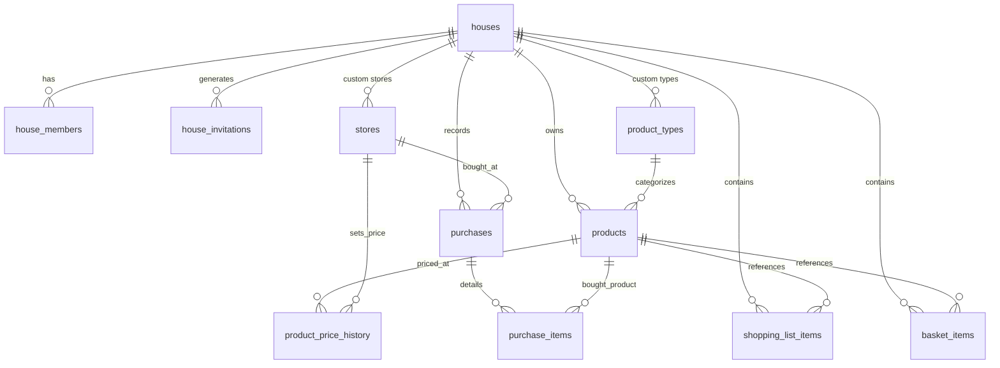

# Especificación Técnica de Backend — `Babasketet.API` (.NET 10)

## 1. Stack y Arquitectura Interna

- **Runtime / Framework**: .NET 10 (`ASP.NET Core`, Minimal APIs o Controllers con OpenAPI nativo `.NET 10`).
- **ORM / BD**: Entity Framework Core 10 + `Npgsql.EntityFrameworkCore.PostgreSQL` contra `babasketet_db`.
- **Tiempo Real**: ASP.NET Core **SignalR** (`/hubs/house`).
- **Validación**: FluentValidation + RFC 9457 `ProblemDetails`.
- **Autenticación**: Esquema dual (Policy Scheme):
  1. **Bearer JWT de `Zitadel` (OIDC/JWKS)** para usuarios registrados (`sub` = `userId`).
  2. **Bearer Device/Guest Token** (JWT emitido por `Babasketet.API` con `deviceId` y `houseId`) para usuarios anónimos (sin registro).

### Estructura de Proyectos Recomendada (`src/Babasketet.API/`)
```text
src/Babasketet.API/
├── Domain/                # Entidades, Value Objects, invariantes de negocio (límites de casas, SCD-2 precios)
├── Application/           # Casos de uso (Vertical Slices por feature), DTOs, validadores
├── Infrastructure/        # EF Core DbContext, configuraciones Fluent API, migraciones, SignalR notifier
├── Api/                   # Endpoints REST v1, Hubs SignalR, middlewares (ProblemDetails, RateLimit, Auth)
├── Dockerfile             # Multi-stage (sdk:10.0 -> aspnet:10.0-alpine)
└── Babasketet.API.csproj
```

---

## 2. Modelo de Datos PostgreSQL (`babasketet_db`)



### 2.1 Tablas Principales

| Tabla | Columnas Clave | Restricciones e Invariantes |
| :--- | :--- | :--- |
| `houses` | `id (uuid PK)`, `name (varchar 100)`, `active_store_id (uuid FK)`, `created_at`, `updated_at` | Nombre obligatorio (1..100 chars). |
| `app_users` | `id (uuid PK)`, `zitadel_user_id (varchar 128 nullable)`, `device_id (uuid nullable)`, `global_role (Guest/User)`, `is_admin (bool)`, `status (Active/Blocked)`, `email`, `display_name`, `auth_method`, `custom_properties_json`, `created_at`, `last_seen_at` | Índices únicos filtrados en `zitadel_user_id` y `device_id`. `Guest` no puede ser `Admin` ni tener `zitadel_user_id`. Migraciones EF Core reversibles en `Migrations/`. |
| `system_email_configs` | `id (uuid PK)`, `host`, `port (1..65535)`, `username`, `encrypted_password`, `security_mode`, `from_email`, `from_name`, `enabled`, `updated_at` | Configuración SMTP saliente persistida en BD con contraseña cifrada (`IDataProtectionProvider`). |
| `admin_notifications` | `id (uuid PK)`, `title`, `body`, `category`, `status (New/Read/Archived)`, `created_at`, `read_at`, `archived_at` | Notificaciones al equipo Admin con envío automático de email a todos los administradores activos. |
| `house_members` | `id (uuid PK)`, `house_id (FK)`, `user_id (varchar 128 nullable)`, `device_id (uuid nullable)`, `role (owner/member)`, `joined_at` | `CHECK (user_id IS NOT NULL OR device_id IS NOT NULL)`, `CHECK (role <> 'owner' OR user_id IS NOT NULL)` y `ux_house_members_single_owner` (solo 1 `owner` por casa y únicamente `User`). Un `device_id` anónimo solo puede tener **1** fila activa; un `user_id` registrado hasta **4**. |
| `house_invitations` | `id (uuid PK)`, `house_id (FK)`, `token_hash (char 64 UNIQUE)`, `created_at`, `expires_at`, `revoked_at` | `expires_at = created_at + interval '1 hour'`. Permite múltiples usos durante esa hora (para enviar a varios dispositivos/familiares) salvo revocación explícita. |
| `stores` | `id (uuid PK)`, `house_id (uuid nullable FK)`, `name (varchar 80)`, `icon_key (varchar 64)`, `is_default (bool)`, `is_system (bool)` | `house_id IS NULL` → catálogo semilla global (las 24 tiendas ES/PT). `house_id IS NOT NULL` → tienda personalizada de esa casa. |
| `product_types` | `id (uuid PK)`, `house_id (uuid nullable FK)`, `name (varchar 80)`, `fill_hex (char 7)`, `border_hex (char 7 nullable)`, `is_system (bool)` | `house_id IS NULL` → 18 tipos por defecto. `house_id IS NOT NULL` → tipos creados por el usuario. |
| `products` | `id (uuid PK)`, `house_id (FK)`, `name (varchar 120)`, `normalized_name (varchar 120)`, `product_type_id (FK nullable)`, `default_format (varchar 20 DEFAULT 'Ud')`, `last_used_at` | `UNIQUE (house_id, normalized_name)`. Alimenta el autocompletado y el botón de "items existentes". |
| `shopping_list_items` | `id (uuid PK)`, `house_id (FK)`, `product_id (FK)`, `product_type_id (FK nullable)`, `format (varchar 20 DEFAULT 'Ud')`, `sort_order (int)`, `created_at` | Representa la pestaña **Lista**. Orden modificable por drag & drop. |
| `basket_items` | `id (uuid PK)`, `house_id (FK)`, `product_id (FK)`, `product_type_id (FK nullable)`, `format (varchar 20 DEFAULT 'Ud')`, `quantity (numeric(10,2) DEFAULT 1)`, `unit_price_override (numeric(10,2) nullable)`, `added_at` | Representa la pestaña **Cesta**. |
| `product_price_history` | `product_id (FK)`, `store_id (FK)`, `price (numeric(10,2))`, `valid_from (timestamptz)`, `valid_to (timestamptz nullable)` | **Histórico SCD Type 2** (ver detalle técnico en sección 2.2). |
| `purchases` | `id (uuid PK)`, `house_id (FK)`, `store_id (FK)`, `purchased_at (timestamptz)`, `calculated_total (numeric(10,2))`, `manual_total (numeric(10,2) nullable)`, `receipt_image_url (text nullable)` | Representa la pestaña **Compras**. `receipt_image_url` bloqueado por feature flag `Premium`. |
| `purchase_items` | `id (uuid PK)`, `purchase_id (FK)`, `product_id (FK)`, `product_name_snapshot`, `product_type_id`, `format`, `quantity`, `unit_price`, `line_total` | Snapshot inmutable de lo comprado en esa fecha. |

---

### 2.2 Diseño Exacto del Histórico de Precios (`product_price_history`) en PostgreSQL

> [!IMPORTANT]
> **Nota técnica crítica sobre `PRIMARY KEY` con columna `NULL` en PostgreSQL**:
> En la especificación de negocio se indica la clave conceptual `(Id Producto, Id Supermercado, Fecha Alta, Fecha Baja)` con la regla *"solo puede existir un registro con Fecha Baja nula"*.
> En SQL estándar y PostgreSQL, ninguna columna perteneciente a una `PRIMARY KEY` puede aceptar `NULL`.

Para cumplir **exactamente** la invariante de negocio en PostgreSQL de forma nativa e infalible:

```sql
CREATE TABLE product_price_history (
    product_id  uuid NOT NULL REFERENCES products(id) ON DELETE CASCADE,
    store_id    uuid NOT NULL REFERENCES stores(id) ON DELETE RESTRICT,
    valid_from  timestamptz NOT NULL,
    valid_to    timestamptz NULL,
    price       numeric(10, 2) NOT NULL CHECK (price >= 0),

    -- Clave primaria natural sin NULLs
    CONSTRAINT pk_product_price_history PRIMARY KEY (product_id, store_id, valid_from),
    -- Garantiza coherencia temporal
    CONSTRAINT ck_product_price_dates CHECK (valid_to IS NULL OR valid_to > valid_from)
);

-- Índice único parcial: GARANTIZA a nivel de motor BD que solo puede existir
-- UN único precio vigente (valid_to IS NULL) por (product_id, store_id)
CREATE UNIQUE INDEX ux_product_price_active
    ON product_price_history (product_id, store_id)
    WHERE valid_to IS NULL;
```

#### Operación Atómica de Actualización de Precio
Cuando el usuario consigna un nuevo precio `P_nuevo` para `(product_id, store_id)`:
1. Abrir transacción (`READ COMMITTED` con bloqueo `SELECT ... FOR UPDATE` sobre la fila activa).
2. Si existe fila activa y `price == P_nuevo`: no hacer nada (evitar ruido histórico).
3. Si existe fila activa y `price != P_nuevo`:
   - `now = DateTimeOffset.UtcNow` (si `now <= active.valid_from`, usar `active.valid_from.AddTicks(10)`).
   - `UPDATE product_price_history SET valid_to = @now WHERE product_id = @p AND store_id = @s AND valid_to IS NULL;`
4. `INSERT INTO product_price_history (product_id, store_id, valid_from, valid_to, price) VALUES (@p, @s, @now, NULL, @P_nuevo);`
5. `COMMIT`.

#### Consulta del Precio Actual
```sql
SELECT price
FROM product_price_history
WHERE product_id = @productId
  AND store_id = @storeId
  AND valid_to IS NULL;
```

---

## 3. Contratos REST API (`/api/v1`)

### Casas e Invitaciones
| Método | Ruta | Descripción |
| :--- | :--- | :--- |
| `GET` | `/api/v1/houses` | Lista las casas accesibles por el usuario/dispositivo actual (máx. 1 anónimo, máx. 4 registrado). |
| `POST` | `/api/v1/houses` | Crea una nueva casa (`{ name }`). Valida el límite 1/4. |
| `POST` | `/api/v1/houses/{houseId}/invitations` | Genera un enlace de invitación válido durante **1 hora** (`{ token, url, expiresAt }`). |
| `POST` | `/api/v1/invitations/{token}/join` | Une al usuario/dispositivo actual a la casa asociada al token. Valida expiración (410 Gone si caducó) y límite 1/4. |
| `POST` | `/api/v1/houses/claim` | Vincula la casa anónima del `deviceId` al `userId` recién autenticado con `WillIAM`. |

### Supermercados (Tiendas) y Tipos de Producto
| Método | Ruta | Descripción |
| :--- | :--- | :--- |
| `GET` | `/api/v1/houses/{houseId}/stores` | Devuelve las 24 tiendas semilla + las personalizadas de la casa. |
| `POST` | `/api/v1/houses/{houseId}/stores` | Añade un nuevo supermercado personalizado (`{ name }`). |
| `PUT` | `/api/v1/houses/{houseId}/active-store` | Cambia el supermercado activo en la casa (`{ storeId }`). |
| `GET` | `/api/v1/houses/{houseId}/product-types` | Devuelve los 18 tipos semilla + personalizados de la casa. |
| `POST` | `/api/v1/houses/{houseId}/product-types` | Crea un tipo personalizado (`{ name, fillHex, borderHex? }`). |

### Productos (Historial y Sugerencias)
| Método | Ruta | Descripción |
| :--- | :--- | :--- |
| `GET` | `/api/v1/houses/{houseId}/products?q=...` | Búsqueda / autocompletado de productos usados anteriormente en la casa. |

### Pestaña `Lista`
| Método | Ruta | Descripción |
| :--- | :--- | :--- |
| `GET` | `/api/v1/houses/{houseId}/list` | Devuelve los items ordenados de la pestaña Lista con su tipo, formato y precio vigente en la tienda activa. |
| `POST` | `/api/v1/houses/{houseId}/list/items` | Añade item por `productId` existente o `name` libre (crea/reutiliza `Product`). |
| `PATCH` | `/api/v1/houses/{houseId}/list/items/{itemId}` | Actualiza `productTypeId`, `format`, `name`. |
| `PUT` | `/api/v1/houses/{houseId}/list/reorder` | Reordena los items (`{ orderedItemIds: uuid[] }`). |
| `POST` | `/api/v1/houses/{houseId}/list/items/{itemId}/move-to-basket` | Mueve el item de `Lista` a `Cesta` (swipe derecha) con cantidad por defecto `1`. |
| `DELETE` | `/api/v1/houses/{houseId}/list/items/{itemId}` | Elimina el item de la `Lista` (swipe izquierda). |

### Pestaña `Cesta` y Precios
| Método | Ruta | Descripción |
| :--- | :--- | :--- |
| `GET` | `/api/v1/houses/{houseId}/basket` | Devuelve los items en la Cesta, el precio vigente para el supermercado activo (si existe) y el `total`. |
| `PATCH` | `/api/v1/houses/{houseId}/basket/items/{itemId}` | Actualiza `name`, `quantity`, `productTypeId` o `format`. |
| `PUT` | `/api/v1/houses/{houseId}/basket/items/{itemId}/price` | Consigna el precio para `(productId, activeStoreId)` ejecutando la lógica SCD-2 en `product_price_history`. |
| `POST` | `/api/v1/houses/{houseId}/basket/items/{itemId}/move-to-list` | Devuelve el item de `Cesta` a `Lista` (swipe izquierda). |
| `DELETE` | `/api/v1/houses/{houseId}/basket/items/{itemId}` | Elimina el item definitivamente de la `Cesta` (opción "Eliminar" en long-press). |
| `POST` | `/api/v1/houses/{houseId}/basket/checkout` | **Efectuar Compra**: crea registro en `purchases` + `purchase_items` y vacía la `Cesta` en una transacción. |

### Pestaña `Compras` (Histórico)
| Método | Ruta | Descripción |
| :--- | :--- | :--- |
| `GET` | `/api/v1/houses/{houseId}/purchases` | Lista histórica de compras (fecha, supermercado, total). |
| `GET` | `/api/v1/houses/{houseId}/purchases/{purchaseId}` | Detalle de elementos de una compra. |
| `PATCH` | `/api/v1/houses/{houseId}/purchases/{purchaseId}/total` | Permite establecer o corregir el total manual de la compra (`{ manualTotal }`). |
| `POST` | `/api/v1/houses/{houseId}/purchases/{purchaseId}/receipt` | Adjuntar foto de ticket — protegido por política `PremiumOnly` (devuelve `403 Forbidden` / `PREMIUM_REQUIRED` en plan Free). |

### Perfil y Panel de Administración (`/api/v1/admin/*` — solo rol `Admin`)
| Método | Ruta | Descripción |
| :--- | :--- | :--- |
| `GET` | `/api/v1/me` | Devuelve perfil, estado (`Active`/`Blocked`), roles efectivos (`Guest`, `User`, `Owner`, `Admin`) y casas/roles del llamante. |
| `GET` | `/api/v1/admin/houses` | Listado de casas con conteos de usuarios, ítems totales, lista, cesta y compras. |
| `GET` | `/api/v1/admin/houses/{houseId}` | Detalle de una casa: usuarios, ítems totales, ítems en Lista, ítems en Cesta y compras con sus ítems. |
| `GET` | `/api/v1/admin/users` | Listado de usuarios registrados (`User`) e invitados (`Guest`) con estado, roles y casas. |
| `GET` | `/api/v1/admin/users/{userId}` | Detalle de usuario con estado, autenticación, propiedades en BD y casas. |
| `PUT` | `/api/v1/admin/users/{userId}` | Edición de estado (`Active`/`Blocked`), rol `Admin`, `Owner` por casa, nombre y propiedades clave-valor en BD. |
| `GET` | `/api/v1/admin/items?q=...` | Catálogo global de ítems ordenados alfabéticamente, con tipo, filtro de texto y agrupación multi-casa (`"N casas"` si coincide texto case-insensitive y tipo). |
| `GET` | `/api/v1/admin/settings/email` | Devuelve la configuración SMTP saliente guardada en BD (sin exponer la contraseña en claro). |
| `PUT` | `/api/v1/admin/settings/email` | Guarda o actualiza la configuración SMTP saliente cifrando la contraseña en reposo. |
| `POST` | `/api/v1/admin/settings/email/test` | Envía un correo electrónico de prueba real mediante SMTP (`MailKit`) al destinatario indicado. |
| `GET` | `/api/v1/admin/notifications` | Listado paginado (10 en 10) de notificaciones con filtro multi-estado (`New`, `Read`, `Archived`, `All`). |
| `POST` | `/api/v1/admin/notifications` | Crea una notificación para administradores y notifica por correo electrónico a todos los admins activos. |
| `PATCH` | `/api/v1/admin/notifications/{id}/status` | Cambia estado (`New`, `Read`, `Archived`) actualizando `read_at` y `archived_at`. |
| `GET` | `/api/v1/admin/invitations` | Lista invitaciones de plataforma filtrables por rango de fecha (`all`, `year`, `6months`, `3months`, `month`, `week`, `24h`) y estado (`Active` por defecto, `Redeemed`, `Cancelled`, `Expired`, `All`). |
| `POST` | `/api/v1/admin/invitations` | Genera una invitación con código único y expiración por defecto a 7 días (modificable o indefinida). |
| `POST` | `/api/v1/admin/invitations/{id}/cancel` | Cancela una invitación activa dejándola no operativa. |
| `POST` | `/api/v1/admin/invitations/{id}/renew` | Renueva una invitación no caducada sumando `1/7/15/30` días o haciéndola indefinida. |
| `POST` | `/api/v1/admin/invitations/{id}/reactivate` | Reactiva una invitación caducada o cancelada por `1/7/15/30` días desde el momento actual. |
| `POST` | `/api/v1/admin/invitations/{id}/send-email` | Envía por SMTP la invitación con enlace `/invitation-redeem/{code}` a la lista de emails indicada. |
| `GET` | `/api/v1/platform-invitations/{code}` | Comprueba públicamente si un código de invitación es válido, activo o expirado. |
| `POST` | `/api/v1/platform-invitations/redeem` | Canjea una invitación activa vinculándola al usuario registrado autenticado. |
| `POST` | `/api/v1/platform-invitations/request-renewal` | Solicita renovación de una invitación válida expirada generando alerta + email para administradores. |

---

## 4. Hub SignalR (`/hubs/house`)

- **Autenticación**: Query string `access_token` (estándar SignalR sobre WebSockets) con JWT de `WillIAM` o `deviceToken`.
- **Métodos Cliente → Servidor**:
  - `JoinHouseGroup(Guid houseId)` (verifica pertenencia en `house_members`)
  - `LeaveHouseGroup(Guid houseId)`
- **Eventos Servidor → Clientes**:
  - `ListUpdated(HouseSyncEvent)`
  - `BasketUpdated(HouseSyncEvent)`
  - `PurchaseCompleted(PurchaseSummaryDto)`
  - `ActiveStoreChanged(Guid storeId)`
  - `CatalogUpdated(string catalogType)` (nueva tienda o nuevo tipo de producto)
