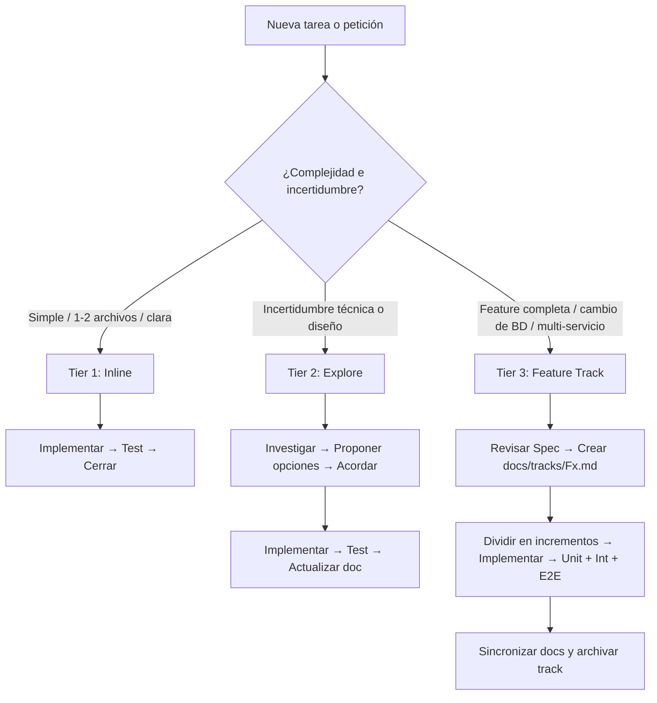

# Metodología: Organic-Driven Development (ODD)

Este proyecto adopta **Organic-Driven Development (ODD)**, inspirado en el flujo de trabajo de **Gentle-AI**, como evolución pragmática de *Spec-Driven Development (SDD)*.

---

## 1. ¿Por qué ODD en lugar de SDD rígido?

El SDD clásico aporta claridad antes de escribir código, pero cuando se aplica de forma rígida obliga a generar múltiples documentos formales incluso para cambios menores (burocracia innecesaria). **ODD** mantiene la disciplina de especificar antes de construir cuando el problema lo exige, pero **escala la estructura dinámicamente según la complejidad real de la tarea**.



---

## 2. Los Tres Niveles Operativos (Tiers)

### Tier 1 — Inline (Cero Ceremonia)
- **Cuándo usarlo**: Corrección de bugs localizados, ajustes de texto/color, añadir un test unitario faltante, tweaks de Dockerfile.
- **Proceso**:
  1. Leer únicamente los archivos implicados.
  2. Aplicar el cambio mínimo necesario.
  3. Ejecutar los tests relevantes.
  4. Reportar el resultado con evidencia de ejecución.

### Tier 2 — Explore (Investigación Ligera)
- **Cuándo usarlo**: Cuando hay varias librerías o patrones posibles (ej. librería de QR en Flutter, estrategia de gestos en CanvasKit, proveedor SMS para MagicLink) o cuando el impacto cruza 2 capas.
- **Proceso**:
  1. Investigar opciones y restricciones del repo.
  2. Presentar una recomendación concisa con pros/contras.
  3. Tras validación (o decisión autónoma si no es disruptiva), implementar y probar.
  4. Si la decisión es arquitectónica y duradera, registrarla como ADR en `docs/architecture/`.

### Tier 3 — Feature Track (Documento Vivo)
- **Cuándo usarlo**: Implementación de cada feature principal (`F1` a `F7`), cambios en el modelo de datos PostgreSQL, integración de `WillIAM` o nuevos flujos E2E.
- **Proceso**:
  1. **Anclar en la Spec**: Leer el bloque correspondiente en `docs/features/features-roadmap.md` y los contratos en `docs/backend/`, `docs/frontend/` o `docs/iam/`.
  2. **Crear Track Vivo**: Abrir un único archivo `docs/tracks/fX-nombre.md` (resistente a cambios de sesión y compactaciones de contexto).
  3. **Ejecución Incremental**: Implementar por cortes verticales (*Vertical Slices*: DB → API → Tests Integración → UI → Playwright) en lugar de capas aisladas sin probar.
  4. **Puerta de Verificación**: No se cierra el track sin pasar todos los criterios de aceptación (`Given/When/Then`) y las suites de test correspondientes.
  5. **Cierre Orgánico**: Consolidar cualquier cambio de diseño en los docs permanentes (`docs/backend/`, `docs/frontend/`, etc.) y marcar el track como completado.

---

## 3. Plantilla de Documento Vivo (`docs/tracks/fX-nombre.md`)

Cada tarea de **Tier 3** utiliza una única ficha ligera como la siguiente:

```markdown
# Track: [F1] Gestión de Casas e Invitaciones

- **Estado**: En progreso | Bloqueado | Verificado | Completado
- **Spec de referencia**: `docs/features/features-roadmap.md#f1-gestion-de-casas`
- **Servicios afectados**: `Babasketet.API`, `Babasketet.WEB`

## Decisiones tomadas durante la ejecución
- (Registrar aquí cualquier ajuste sobre la spec original y su motivo)

## Incrementos (Vertical Slices)
- [ ] Slice 1: Migración PostgreSQL `houses` + `house_invitations` + endpoint crear casa + test integración
- [ ] Slice 2: Generación de token 1h + endpoint unirse + test integración TTL expirado
- [ ] Slice 3: UI Flutter onboarding (crear/unirse) + deep-link `/join/:token` + compartir WhatsApp/Email/QR
- [ ] Slice 4: Test E2E Playwright (2 contextos creando y uniéndose a la misma casa)

## Verificación
- [ ] Unitarios OK (`dotnet test`, `flutter test`)
- [ ] Integración OK (Testcontainers)
- [ ] E2E Playwright OK
- [ ] Documentación permanente sincronizada
```

---

## 4. Memoria Persistente y Contexto entre Sesiones

Siguiendo el principio de continuidad de **Gentle-AI**:
- El conocimiento estable vive en `AGENTS.md` y `docs/`.
- Las decisiones estructurales irreversibles o costosas viven en `docs/architecture/adr-*.md`.
- El progreso en curso de una feature vive en `docs/tracks/` para que cualquier sesión nueva o agente distinto pueda retomar el trabajo exactamente donde quedó sin releer todo el historial de chat.
